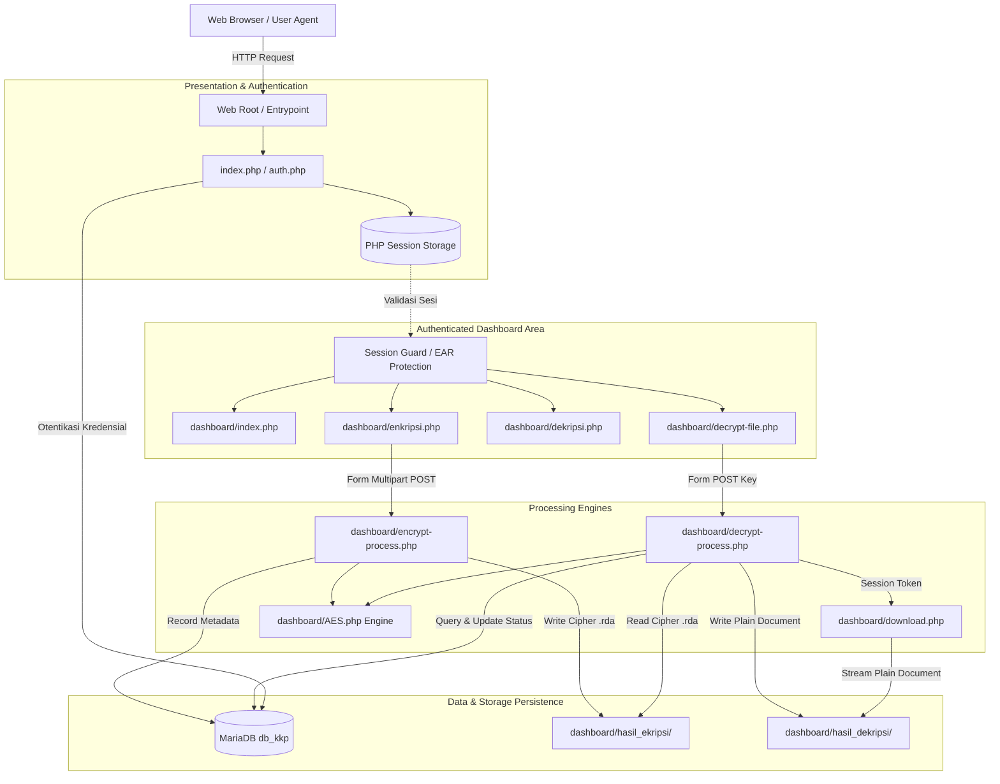
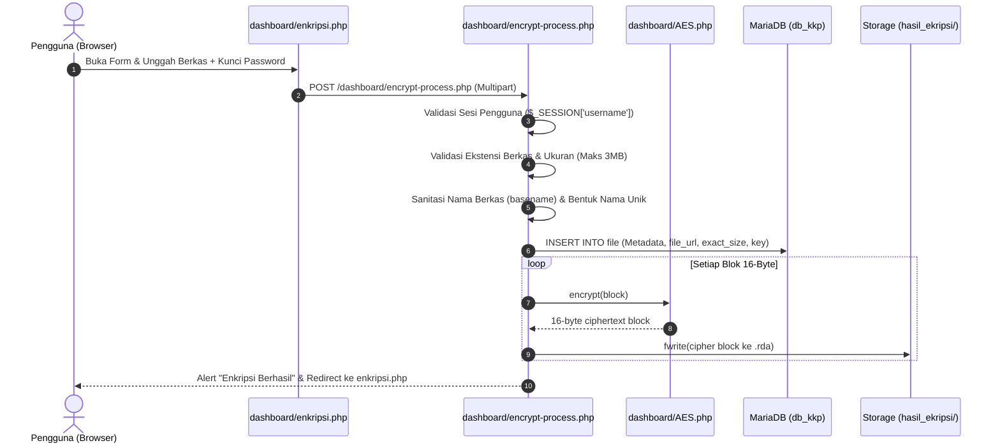
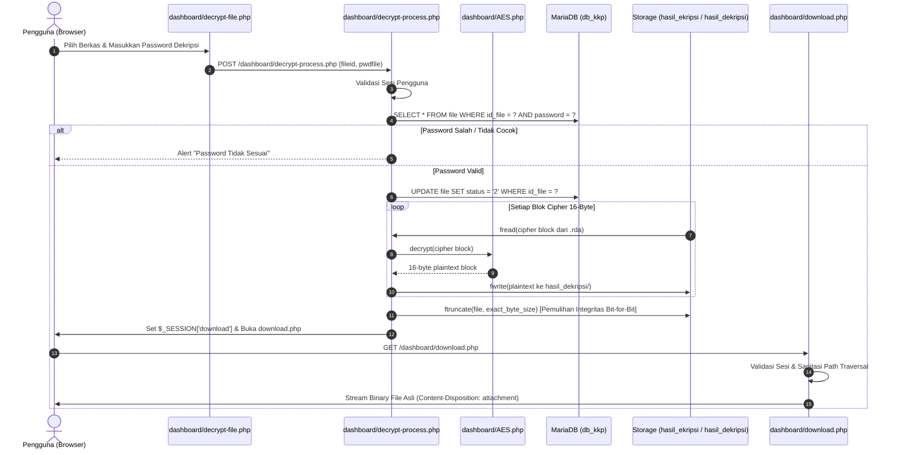

# SYSTEM ARCHITECTURE & CRYPTOGRAPHIC DESIGN
**Project:** kripto_file (Aplikasi Web Kriptografi File Berbasis AES-128)  
**Date:** 2026-10-22  
**Status:** Canonical Verified Architecture  

---

## 1. Arsitektur Komponen Tingkat Tinggi

Aplikasi `kripto_file` mengadopsi arsitektur monolitik PHP Native dengan pemisahan fungsional berbasis modul direktori.

---

## 2. Alur Enkripsi Berkas (Sequence Diagram)

---

## 3. Alur Dekripsi & Pengunduhan Berkas (Sequence Diagram)

---

## 4. Desain Mesin Kriptografi (AES-128 Implementation)

Modul `dashboard/AES.php` mengimplementasikan spesifikasi Federal Information Processing Standards (FIPS 197) untuk Rijndael Cipher Block:
1. **Block Length ($Nb$):** 4 words (16 bytes = 128 bits).
2. **Key Length ($Nk$):** 4 words (16 bytes = 128 bits).
3. **Number of Rounds ($Nr$):** 10 putaran ($Nk + Nb + 2$).
4. **Transformasi Putaran:**
   - `SubByte`: Substitusi non-linear byte menggunakan S-Box statis.
   - `ShiftRow`: Pergeseran sirkular baris matriks status (baris 1 shift 0, baris 2 shift 1, baris 3 shift 2, baris 4 shift 3).
   - `MixColumns`: Perkalian polinomial modulo $x^4 + 1$ di atas Galois Field $GF(2^8)$ menggunakan log table dan anti-log table.
   - `AddRoundKey`: Bitwise XOR antara matriks status dan sub-key jadwal kunci ($w$).
5. **Kompatibilitas Runtime:**
   Modul telah diperbarui untuk mendukung konstruktor standar PHP 8 (`__construct`) sekaligus mempertahankan alias `AES()` untuk backward compatibility.
6. **Integritas Padding:**
   Sistem enkripsi mengisi byte nol (`\0`) pada blok terakhir yang kurang dari 16 byte. Pemotongan pasca dekripsi menggunakan metadata ukuran eksak (`ftruncate`) memastikan berkas hasil dekripsi 100% bit-for-bit identik dengan file asli.
