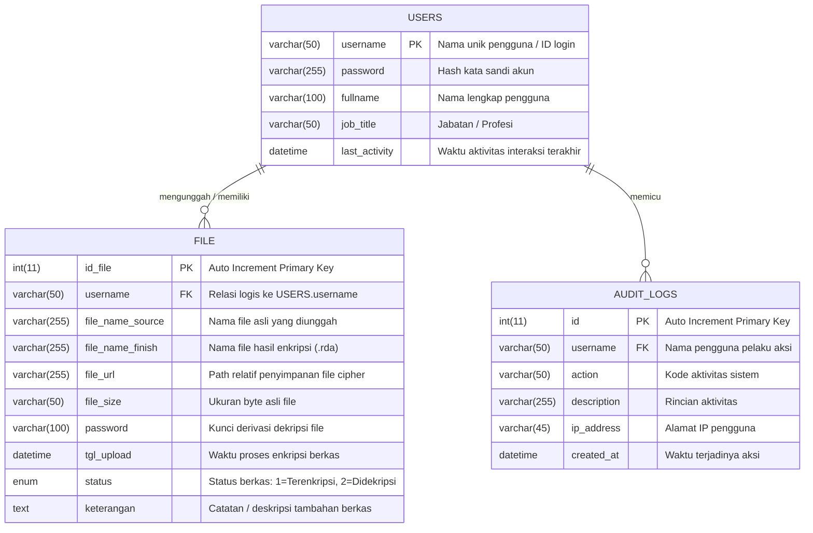

# ENTITY RELATIONSHIP DIAGRAM (ERD) & DATA DICTIONARY
**Project:** kripto_file (Aplikasi Web Kriptografi File Berbasis AES-128)  
**Database Name:** `db_kkp`  
**RDBMS:** MySQL / MariaDB (InnoDB Engine, utf8mb4)  
**Date:** 2026-10-22  

---

## 1. Visual Diagram Hubungan Entitas (Mermaid ERD)

---

## 2. Kamus Data (Data Dictionary)

### 2.1 Tabel `users`
Menyimpan identitas kredensial dan metadata akun pengguna yang diizinkan mengakses aplikasi.

| Kolom | Tipe Data | Nullable | Default | Keterangan |
|---|---|---|---|---|
| `username` | VARCHAR(50) | NO | - | **Primary Key**. Nama unik akun pengguna. |
| `password` | VARCHAR(255) | NO | - | Hash kata sandi pengguna (MD5 / Bcrypt). |
| `fullname` | VARCHAR(100) | NO | - | Nama lengkap resmi pengguna untuk tampilan dashboard. |
| `job_title` | VARCHAR(50) | NO | - | Jabatan kerja pengguna (misal: "Security Officer"). |
| `last_activity` | DATETIME | YES | NULL | Waktu timestamp aktivitas terakhir pengguna pada sesi login. |

### 2.2 Tabel `file`
Menyimpan metadata berkas digital yang diproses oleh modul enkripsi dan dekripsi.

| Kolom | Tipe Data | Nullable | Default | Keterangan |
|---|---|---|---|---|
| `id_file` | INT(11) | NO | AUTO_INCREMENT | **Primary Key**. ID numerik unik setiap berkas. |
| `username` | VARCHAR(50) | NO | - | **Foreign Key Logis**. Merujuk pada `users.username` pemilik berkas. |
| `file_name_source` | VARCHAR(255) | NO | - | Nama asli berkas beserta prefix unik saat diunggah. |
| `file_name_finish` | VARCHAR(255) | NO | - | Nama berkas cipher dengan ekstensi `.rda`. |
| `file_url` | VARCHAR(255) | NO | - | Path relatif penyimpanan file cipher fisik (contoh: `hasil_ekripsi/12345.rda`). |
| `file_size` | VARCHAR(50) | NO | - | Ukuran asli berkas dalam satuan byte untuk rekonstruksi eksak padding. |
| `password` | VARCHAR(100) | NO | - | Kunci enkripsi 16-karakter turunan password berkas. |
| `tgl_upload` | DATETIME | NO | - | Timestamp saat proses enkripsi berkas selesai. |
| `status` | ENUM('1', '2') | NO | '1' | Status operasional: `'1'` = Terenkripsi, `'2'` = Didekripsi. |
| `keterangan` | TEXT | YES | NULL | Deskripsi bebas terkait isi atau peruntukan berkas. |

### 2.3 Tabel `audit_logs`
Menyimpan jejak audit keamanan seluruh aktivitas penting di dalam sistem.

| Kolom | Tipe Data | Nullable | Default | Keterangan |
|---|---|---|---|---|
| `id` | INT(11) | NO | AUTO_INCREMENT | **Primary Key**. ID numerik entri log. |
| `username` | VARCHAR(50) | NO | - | Nama pengguna yang menjalankan aksi. |
| `action` | VARCHAR(50) | NO | - | Kode aksi (`LOGIN_SUCCESS`, `LOGIN_FAILED`, `ENCRYPT_FILE`, `DECRYPT_SUCCESS`, `DECRYPT_FAILED`, `DOWNLOAD_CIPHER`, `DOWNLOAD_PLAIN`, `DELETE_FILE`, `CHANGE_PASSWORD`). |
| `description` | VARCHAR(255) | YES | NULL | Deskripsi teks rincian aktivitas. |
| `ip_address` | VARCHAR(45) | YES | NULL | Alamat IP klien pengguna. |
| `created_at` | DATETIME | NO | - | Waktu terjadinya aksi. |

---

## 3. Relasi & Integritas Referensial

1. **Kardinalitas:** 1-to-N (`USERS` to `FILE`). Satu user dapat mengunggah banyak file terenkripsi.
2. **Constraint Logis:** Kolom `file.username` berkorelasi dengan `users.username`. Pada implementasi native saat ini relasi ditegakkan pada tingkat aplikasi; foreign key fisik dapat ditambahkan via migrasi DDL jika diperlukan integritas referensial ketat (CASCADE / RESTRICT).
